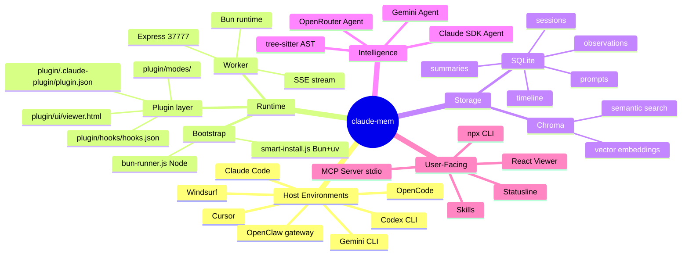
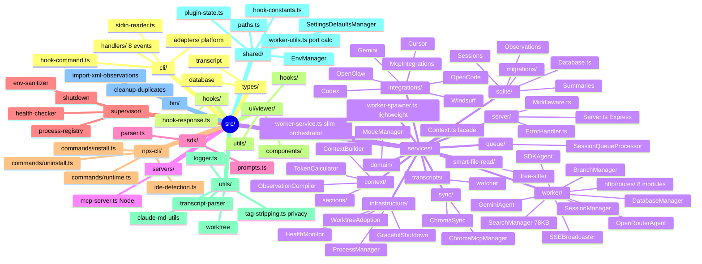
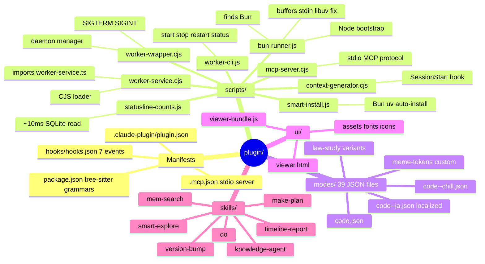
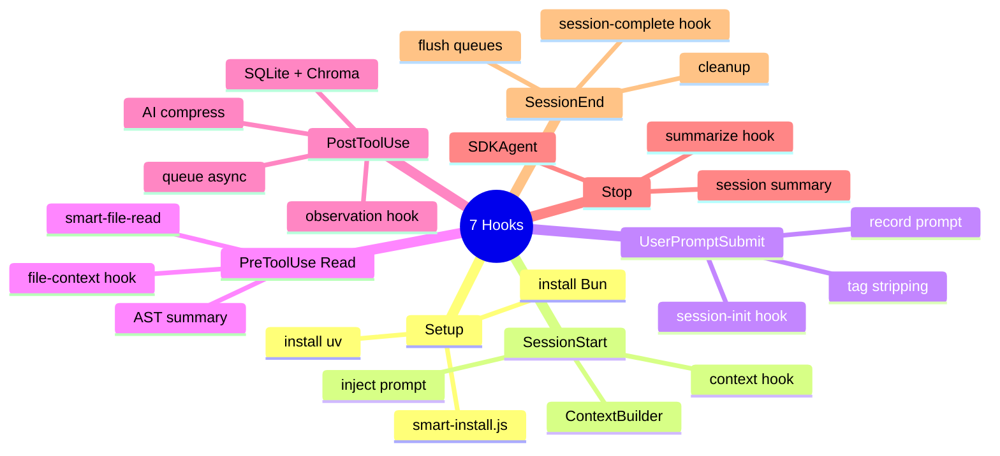
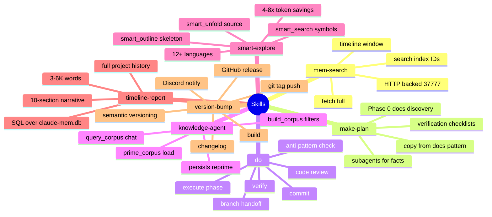
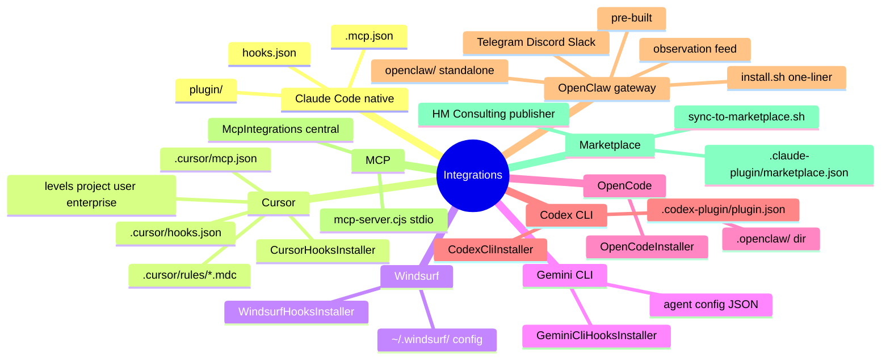
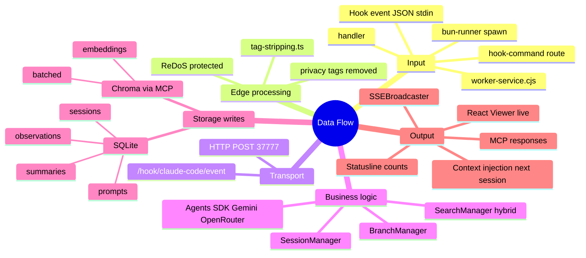
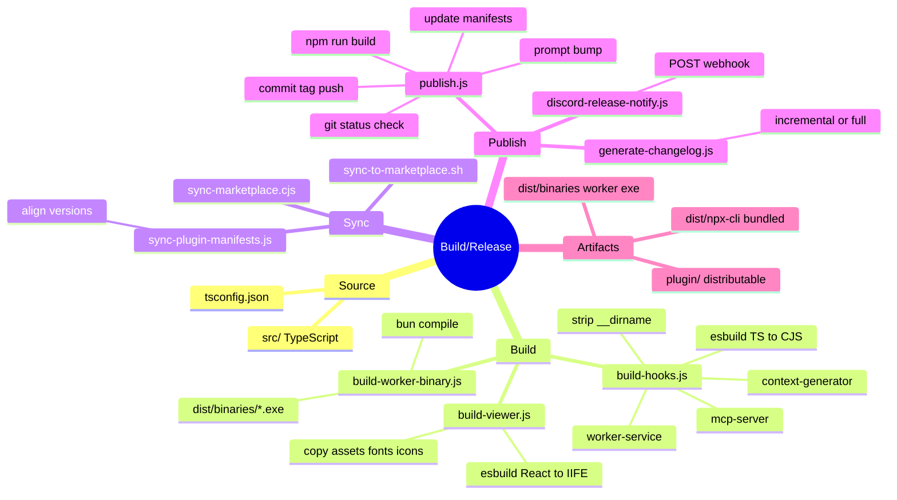
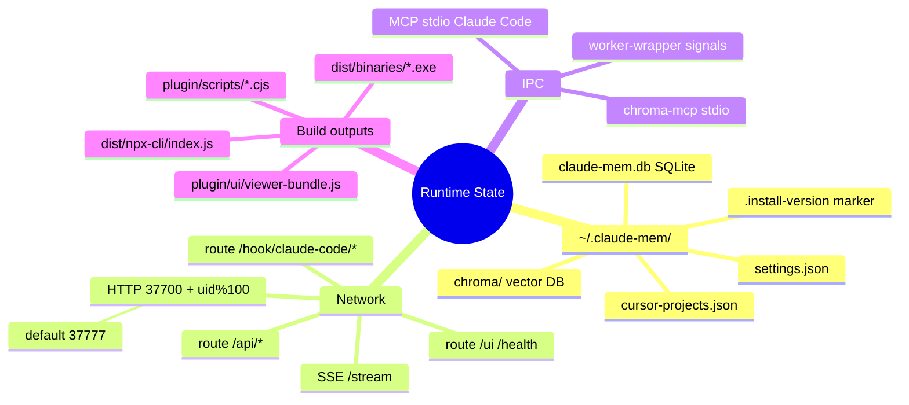

# Claude-Mem Mind Maps

Mermaid `mindmap` diagrams. GitHub, VS Code's Markdown preview, and most Markdown viewers render these natively. For standalone rendering, paste into [mermaid.live](https://mermaid.live).

---

## 1. Global Architecture

---

## 2. Source Tree (`src/`)

---

## 3. Plugin Runtime (`plugin/`)

---

## 4. Lifecycle Hooks

---

## 5. Skills

---

## 6. Integrations & Distribution

---

## 7. Data Flow (hook → storage → UI)

---

## 8. Build & Release

---

## 9. Storage & Ports

